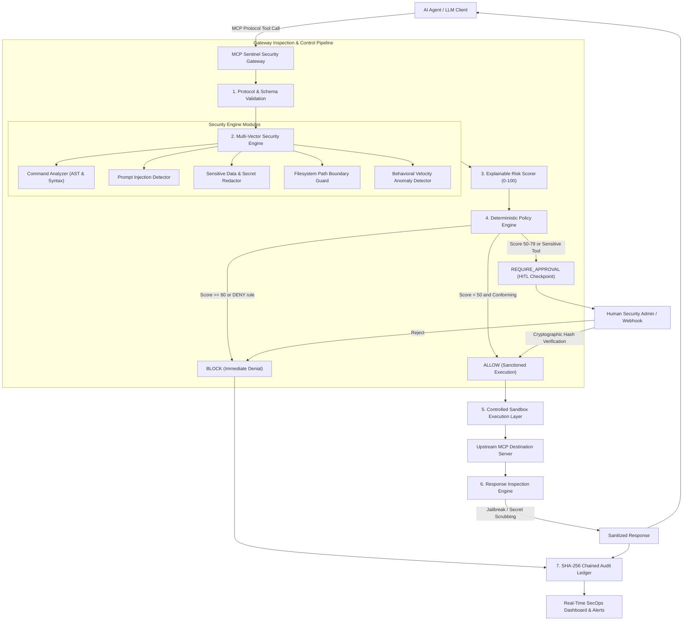

# MCP Sentinel Architecture Specification

## 1. Executive Summary

**MCP Sentinel** is an enterprise-grade AI agent security firewall and tool execution protection gateway designed specifically for the Model Context Protocol (MCP). It intercepts, inspects, scores, controls, and cryptographically audits every tool call between AI agents and external resources (operating systems, filesystems, databases, cloud APIs, and MCP servers) before execution occurs.

---

## 2. Layered Architecture Deep Dive

### 2.1 MCP Protocol Interception & Gateway Core
The gateway operates as a transparent proxy adhering strictly to the official Model Context Protocol (MCP) JSON-RPC specification.
- **Transports Supported**: Stdio (process stdin/stdout streams) and HTTP with Server-Sent Events (SSE).
- **Tool Registration & Discovery**: Connects to upstream registered MCP servers, collects tool metadata (`tools/list`), and indexes schemas with strict input parameter typing.
- **Fail-Closed Guarantee**: Unregistered tools or malformed JSON-RPC requests are rejected deterministically before any processing occurs.

### 2.2 Security Analysis Engine (5 Specialized Modules)
1. **Dangerous Command Analyzer**:
   - Parses shell command lines into tokens and structural elements.
   - Detects destructive disk commands (`rm -rf`, `mkfs`, `fdisk`), reverse shell payloads (`nc -e`, `/dev/tcp`, `python pty`), privilege escalation (`sudo`, `su`, `chmod 777`), download-and-execute pipelines (`curl | sh`, `wget | bash`), and suspicious PowerShell flags (`-EncodedCommand`, `DownloadString`).
2. **Prompt Injection & Adversarial Instruction Detector**:
   - Analyzes tool parameters, descriptions, and outputs for prompt override patterns, system delimiter spoofing (`[SYSTEM]`, `Assistant:`, `<system>`), persona manipulation, and indirect instruction injection.
3. **Sensitive Data & Secret Redaction Engine**:
   - Scans for 12+ API key signatures (OpenAI, AWS, GitHub, Stripe, Slack, GCP), asymmetric private keys (`BEGIN RSA PRIVATE KEY`), JWT tokens, database connection strings, and credential passwords.
   - Applies deep recursive redaction before audit storage or display (`[REDACTED_API_KEY]`).
4. **Filesystem Path Boundary Guard**:
   - Enforces canonical path resolution (`os.path.realpath`) against whitelisted base directories.
   - Detects directory traversal patterns (`../`, `%2e%2e%2f`), blacklisted sensitive files (`.env`, `id_rsa`, `/etc/shadow`, cloud tokens), and blocked executable write extensions (`.exe`, `.sh`, `.bat`, `.ps1`).
5. **Behavioral Velocity & Anomaly Engine**:
   - Implements a sliding-window counter tracking invocations per minute.
   - Flags burst rates and repeated policy violations (consecutive block attempts).

### 2.3 Explainable Risk Scoring Engine
The risk engine converts security findings into a normalized, deterministic score from **0 to 100**:
- **0–19: Low**: Safe read operations and diagnostics.
- **20–39: Guarded**: Monitored tools with minor sensitive patterns.
- **40–59: Medium**: Potentially impacting operations (write/file modifications).
- **60–79: High**: Destructive capabilities or privilege-escalating arguments.
- **80–100: Critical**: Blatant attacks (reverse shells, root wipe, credential theft).

Every evaluation outputs full explainability metadata: identifying the contributing factors, detection modules triggered, and recommended remediation.

### 2.4 Deterministic Policy Engine
Policy decisions follow a strict, non-overridable hierarchy:
$$\text{Decision} = \text{DENY} \succ \text{REQUIRE\_APPROVAL} \succ \text{ALLOW}$$
- If any active deny rule or critical threat triggers (Score $\ge 80$), the decision is **BLOCK**.
- If score is between 50 and 79, or if the tool is designated `requires_approval`, the decision is **REQUIRE_APPROVAL**.
- If score is $<50$ and all invariants hold, the decision is **ALLOW**.
- **Security Invariant**: External AI models or LLM advisors are strictly advisory and *cannot override* deterministic policy decisions.

### 2.5 Human-in-the-Loop (HITL) Approval Checkpoint
When an operation requires human intervention:
1. The gateway pauses execution and generates an `ApprovalRequest` record with a 300-second TTL.
2. The exact argument payload is hashed using SHA-256:
   $$\text{ArgHash} = \text{SHA-256}(\text{CanonicalJSON}(\text{arguments}))$$
3. When the administrator approves the request, the gateway verifies that the executed arguments match $\text{ArgHash}$ exactly, preventing replay or parameter-tampering attacks.

### 2.6 Controlled Sandbox Execution Layer
Approved tool invocations are executed within an isolated runtime environment:
- Enforces strict process timeouts (default 10s) and non-root user execution.
- Restricts disk writes to isolated per-session sandbox directories (`storage/sandboxes/{session_id}`).
- Captures standard output, error streams, and exit codes cleanly.

### 2.7 Tool Response Inspection Engine
External tool responses are treated as untrusted data:
- Scans responses for secondary prompt injection or jailbreak payloads targeting the agent's context window.
- Redacts inadvertent credential leakage returned by external APIs.

### 2.8 Tamper-Evident Cryptographic Audit Ledger
Every tool request, decision, approval, and alert is recorded in an immutable audit ledger:
- Each log entry is cryptographically linked to the preceding entry using SHA-256 hash chaining:
  $$H_0 = \text{GENESIS\_BLOCK}$$
  $$H_i = \text{SHA-256}(H_{i-1} \parallel \text{Timestamp} \parallel \text{Actor} \parallel \text{Action} \parallel \text{Resource} \parallel \text{Details})$$
- Mathematical non-repudiation: Any manual database tampering or modification breaks the hash chain, immediately detected by the `/api/audit/verify-chain` endpoint.

---

## 3. Threat Boundaries and Trust Assumptions

| Boundary | Inbound Trust | Outbound Control | Defense Mechanism |
|---|---|---|---|
| **AI Agent $\rightarrow$ Gateway** | Untrusted | Validated | Protocol validation, command analysis, path canonicalization |
| **Gateway $\rightarrow$ MCP Server** | Sandboxed | Restricted | Controlled execution, parameter freezing, isolated directories |
| **MCP Server $\rightarrow$ Agent** | Untrusted | Sanitized | Response inspector, prompt injection scrub, credential masking |
| **Admin UI $\rightarrow$ Gateway** | Authenticated | Audited | JWT auth (HS256), SHA-256 argument verification, RBAC |
